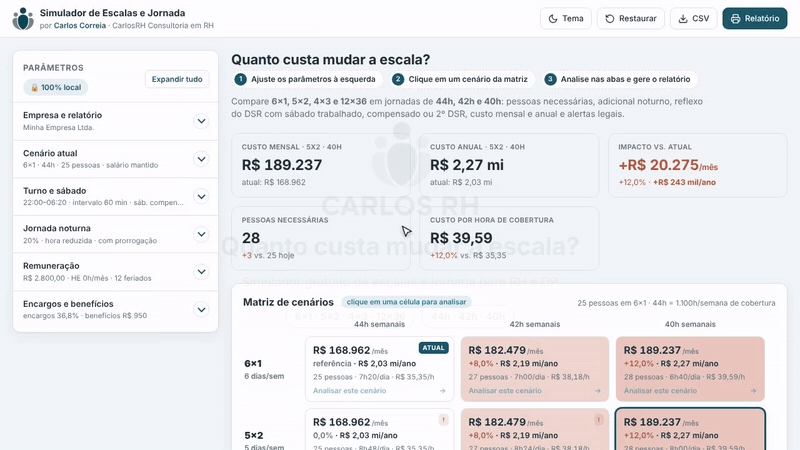

# Simulador de Escalas e Jornada

**Quanto custa mudar a escala?** Compare 6x1, 5x2, 4x3 e 12x36 em jornadas de 44h, 42h e 40h e descubra o custo mensal e anual, as pessoas necessárias e os alertas legais — em 2 minutos.

### 🔗 [Usar online](https://carloscorreiarh.github.io/simuladordeescalas/) · ⬇️ [Baixar o arquivo](https://github.com/carloscorreiarh/simuladordeescalas/releases/latest/download/simulador-escalas.html)

---

## Para quem é

Analistas, coordenadores e gestores de RH e DP que precisam responder à diretoria: *"se mudarmos a escala ou reduzirmos a jornada, quanto vai custar?"*

## O que a ferramenta faz

- **Matriz de 9 cenários + 12x36:** escalas 6x1, 5x2 e 4x3 em 44h, 42h e 40h
- **Pessoas necessárias** para manter a mesma cobertura do quadro atual
- **Adicional noturno** com hora reduzida (52min30s) opcional e prorrogação após as 5h
- **Sábado trabalhado, compensado ou 2º DSR**, com reflexo do DSR calculado automaticamente
- **Custo mensal e anual** por colaborador e total: salário, adicionais, DSR, feriados, provisões de férias + 1/3 e 13º, encargos e benefícios
- **Memória de cálculo** comparando 44h × 42h × 40h, com todas as fórmulas
- **Alternativa por horas extras:** quanto custaria manter o quadro e cobrir a diferença com HE
- **Alertas legais:** interjornada, intervalo, limite de 10h, compensação e 12x36
- **Relatório A4** em layout corporativo, pronto para imprimir ou salvar em PDF
- Tema claro e escuro e layout responsivo (computador e celular)

## 🔒 Privacidade

Tudo roda no seu navegador. **Nenhum dado é enviado a servidores** — adequado à LGPD. Os parâmetros ficam salvos apenas no seu próprio navegador.

## Como usar

1. Abra o link **Usar online** ou baixe o arquivo e dê dois cliques nele
2. Ajuste os parâmetros à esquerda (quadro, turno, sábado, remuneração e encargos)
3. Clique em um cenário da matriz para analisar
4. Clique em **Relatório** para imprimir ou salvar em PDF (Ctrl+P → "Salvar como PDF")

Não precisa instalar nada: é um único arquivo HTML que funciona offline.

## Premissas

- Horário noturno urbano: 22h às 5h (art. 73 da CLT); prorrogação conforme Súmula 60, II, do TST
- Divisor: carga semanal × 5 (220, 210 ou 200)
- 12x36: DSR, feriados e prorrogação noturna considerados quitados (art. 59-A da CLT)
- Reflexo do DSR: dias de repouso ÷ dias úteis do mês
- Encargos: INSS patronal, RAT×FAP, terceiros e FGTS sobre remuneração e provisões

> ⚠️ Simulação gerencial. Não considera insalubridade/periculosidade, PLR, banco de horas nem regras específicas da sua convenção coletiva. Valide os resultados com sua assessoria jurídica.

## Autor

**Carlos Correia** — CarlosRH · Consultoria em Recursos Humanos

- ✉️ contato@carlosrh.net
- 📱 (51) 99169-6233
- 💼 [linkedin.com/in/rh-carlos](https://www.linkedin.com/in/rh-carlos/)
- 📷 [@carlosrh.ofc](https://www.instagram.com/carlosrh.ofc/)

Sugestões e melhorias são bem-vindas: abra uma *issue* aqui no GitHub ou me chame no LinkedIn.
